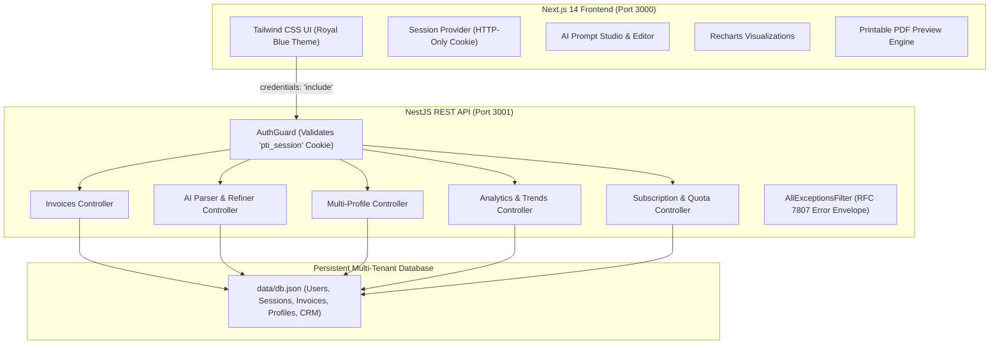

# PromptToInvoice ⚡

<p align="center">
  
  
  
  
  
  
</p>

> **AI-Powered Multi-Tenant Invoicing Platform for Global Consultants, Boutiques & Growing Agencies.**  
> Crafted with **NestJS**, **Next.js 14**, and **Tailwind CSS** featuring a modern Royal Blue palette (`#2563EB` / `#1E40AF`), conversational natural language invoice generation, bank-grade HTTP-only cookie authentication, and multi-currency tax calculations.

---

## 📑 Table of Contents

- [Overview](#-overview)
- [System Architecture](#-system-architecture)
- [Key Features](#-key-features)
  - [1. Conversational AI Invoice Studio](#1-conversational-ai-invoice-studio)
  - [2. Multi-Tenant User Isolation & Security](#2-multi-tenant-user-isolation--security)
  - [3. Financial Analytics & Interactive Visualizations](#3-financial-analytics--interactive-visualizations)
  - [4. Precision Printable & PDF Invoicing](#4-precision-printable--pdf-invoicing)
  - [5. Multi-Entity Business Profiles & Tax Compliance](#5-multi-entity-business-profiles--tax-compliance)
  - [6. Client CRM & Accounts Receivable](#6-client-crm--accounts-receivable)
  - [7. Tiered Subscription & Usage Quota Engine](#7-tiered-subscription--usage-quota-engine)
- [Pre-seeded Demo Accounts](#-pre-seeded-demo-accounts)
- [Project Directory Structure](#-project-directory-structure)
- [Quick Start Guide](#-quick-start-guide)
  - [Prerequisites](#prerequisites)
  - [Monorepo Installation](#monorepo-installation)
  - [Running the Services](#running-the-services)
- [REST API Reference](#-rest-api-reference)
  - [Authentication Endpoints](#authentication-endpoints)
  - [Invoice Endpoints](#invoice-endpoints)
  - [AI Invoice Studio Endpoints](#ai-invoice-studio-endpoints)
  - [Analytics & Reports](#analytics--reports)
  - [Business Profiles](#business-profiles)
  - [Clients Directory](#clients-directory)
  - [Subscriptions & Tiers](#subscriptions--tiers)
  - [Health & Diagnostics](#health--diagnostics)
- [Error Handling Standards](#-error-handling-standards)
- [Git Conventions & Contributing](#-git-conventions--contributing)
- [License](#-license)

---

## 🌐 Overview

**PromptToInvoice** addresses the operational friction independent consultants, software engineers, and boutique agencies face when billing international clients across North America and Europe. Instead of wrestling with rigid accounting forms, users simply describe deliverables in plain English:

> *"Bill Acme Corp 15 hours of full-stack engineering at $120/hr, net 30, with 20% tax."*

The generative NLP engine parses client identities, currency symbols, hourly rates, discount structures, VAT/tax codes, and payment terms, assembling a validated, mathematically consistent invoice draft in sub-second latency.

---

## 🏛️ System Architecture



---

## 🌟 Key Features

### 1. Conversational AI Invoice Studio
- **Plain-English Parsing**: Transforms natural language descriptions into complete line-item invoices:
  - `"40 hours mobile app development at $95/hr with 10% discount for Stripe"`
  - `"Cloud DevOps retainer for Hooli Cloud EU €3,200 EUR with 20% VAT, due in 14 days"`
  - `"3 UI design sprints at $2,500 each for Linear, PO #9921, due upon receipt"`
- **Entity Matching**: Automatically resolves matching clients from the CRM and associates the active business profile.
- **Conversational Refinement**: Modify existing drafts conversationally without manual typing:
  - *"Switch currency to EUR"*
  - *"Add $150 travel expense"*
  - *"Apply 5% promotional discount"*
  - *"Change terms to Net 15 days"*

### 2. Multi-Tenant User Isolation & Security
- **Strict Data Segregation**: Every entity (`Invoice`, `Client`, `BusinessProfile`, `SubscriptionInfo`, `ActivityItem`) is scoped by `userId`. Users cannot view or modify another tenant's records.
- **Zero LocalStorage Tokens**: Eliminates vulnerability to Cross-Site Scripting (XSS) by eschewing localStorage key storage.
- **HTTP-Only Cookies**: Authentication is governed via `pti_session` cookies configured with `HttpOnly: true`, `SameSite: Lax`, and `Path: /`.
- **Server-Side Session Invalidation**: Logging out immediately removes session records on the server and expires the client cookie.

### 3. Financial Analytics & Interactive Visualizations
- **Monthly Revenue Area Chart**: Tracks gross billings against collected cash across the trailing 6 months.
- **Invoice Status Donut Chart**: Real-time distribution across `Draft`, `Sent`, `Paid`, and `Overdue` states.
- **Multi-Currency Distribution**: Visual allocation between USD ($), EUR (€), and GBP (£) receivables.
- **AI Cashflow Insights**: Heuristic analysis detecting overdue accounts, collection rate velocity, and multi-currency billing health.

### 4. Precision Printable & PDF Invoicing
- **A4 Portrait Alignment**: Optimized `@page` CSS layout matching European (ISO 216) and US Letter standards.
- **Status Watermarks**: Distinct visual stamps for settled invoices (`PAID`), overdue alerts, and sent statuses.
- **Comprehensive Breakdowns**: Itemized unit rates, line-item taxes, subtotal, discount deductions, and grand totals.
- **Wire Settlement Card**: Bank details, IBAN, SWIFT/BIC, and ACH routing information rendered directly on the invoice.
- **Zero-Friction Print**: Click "Print / Export PDF" to trigger the browser's native PDF generation with clean printing stylesheets.

### 5. Multi-Entity Business Profiles & Tax Compliance
- **Multiple Brands / Personas**: Manage multiple trading entities (e.g., an LLC consulting firm in USD and a European agency in EUR).
- **Localized Tax Identifiers**: Support for US EIN, European VAT numbers, and UK Company Registration numbers.
- **Default Currency & Payment Terms**: Configurable default terms (Net 15, Net 30, Due upon receipt) per profile.

### 6. Client CRM & Accounts Receivable
- **Client Registry**: Contact names, corporate entity names, billing addresses, and tax identifiers.
- **Dynamic Ledger**: Live calculation of total billed amount and outstanding receivables balance per client.
- **Quick Invoicing Link**: Click any client to filter their billing history or initiate a targeted invoice.

### 7. Tiered Subscription & Usage Quota Engine
Faithfully implements the business tiers specified in `project.docx`:
| Tier | Price | Monthly Invoices | Profiles | Features |
| :--- | :--- | :--- | :--- | :--- |
| **Starter** | Free ($0) | 5 invoices / mo | 1 Profile | USD & EUR, Standard PDF, Manual Invoicing |
| **Professional** | $15 / mo | Unlimited | 3 Profiles | AI Prompt Studio, Multi-Currency (USD, EUR, GBP), Dashboards |
| **Business** | $39 / mo | Unlimited | 10 Profiles | Team Collaboration, Advanced Reports, Custom Branding |
| **Enterprise** | $99 / mo | Unlimited | 50 Profiles | REST API Access, Dedicated SLA, Accounting Software Sync |

---

## 👥 Pre-seeded Demo Accounts

Two pre-configured accounts are seeded for instantaneous evaluation:

```
┌─────────────────────────────────┬─────────────────────────────────┐
│ 🇺🇸 Account 1: Jane Doe          │ 🇪🇺 Account 2: Marcus Lindberg   │
├─────────────────────────────────┼─────────────────────────────────┤
│ Email: jane@aurastudio.com      │ Email: marcus@nordicdigital.io  │
│ Password: password123           │ Password: password123           │
│ Entity: Aura Studio LLC (USA)   │ Entity: Nordic Digital Oy (EU)  │
│ Currency: USD ($)               │ Currency: EUR (€) / GBP (£)     │
│ Plan: Professional ($15/mo)     │ Plan: Business ($39/mo)         │
│ Seed Invoices: INV-2026-001..03 │ Seed Invoices: INV-2026-004..05 │
└─────────────────────────────────┴─────────────────────────────────┘
```

> **Tip**: Use the **1-Click Quick Demo Switcher** pills on the Login Page to instantly test tenant switching and data isolation.

---

## 📁 Project Directory Structure

```
Next/
├── backend/                       # NestJS Backend Application
│   ├── src/
│   │   ├── common/                # Global Exception Filters & Interceptors
│   │   │   └── all-exceptions.filter.ts
│   │   ├── database/              # Data Store & Schemas
│   │   │   ├── data-store.ts      # Multi-tenant atomic file-backed store
│   │   │   └── models.ts          # TypeScript interfaces (User, Invoice, Client, etc.)
│   │   ├── modules/
│   │   │   ├── ai/                # NLP invoice extraction & refinement
│   │   │   ├── analytics/         # Metrics aggregation & monthly trends
│   │   │   ├── auth/              # Cookie sessions, login, register, guards
│   │   │   ├── clients/           # Client CRM directory
│   │   │   ├── invoices/          # Invoice CRUD, payments & A4 PDF renderer
│   │   │   ├── profiles/          # Business profiles management
│   │   │   └── subscriptions/     # Tier management & quota checks
│   │   ├── app.module.ts          # Root module
│   │   └── main.ts                # App bootstrapper (Swagger, Cookies, CORS)
│   ├── .env.example
│   ├── .gitignore
│   ├── package.json
│   └── tsconfig.json
│
├── frontend/                      # Next.js 14 Frontend Application
│   ├── src/
│   │   ├── app/
│   │   │   ├── layout.tsx         # Root HTML layout with Inter font
│   │   │   └── page.tsx           # Main workspace & session gateway
│   │   ├── components/            # UI Components
│   │   │   ├── AiStudioView.tsx   # Generative AI invoice prompt studio
│   │   │   ├── ClientsView.tsx    # Client CRM directory & balances
│   │   │   ├── DashboardView.tsx  # KPI metrics & Recharts graphs
│   │   │   ├── InvoicesView.tsx   # Invoices table, status filters, payment modal
│   │   │   ├── LoginPage.tsx      # Animated glassmorphism login & register
│   │   │   ├── ManualInvoiceModal.tsx # Traditional multi-item invoice modal
│   │   │   ├── Navbar.tsx         # Top bar with currency switch & profile menu
│   │   │   ├── PricingView.tsx    # Subscription plan selector
│   │   │   ├── ProfilesView.tsx   # Business profiles & bank details editor
│   │   │   └── Sidebar.tsx        # Responsive navigation drawer & entity switcher
│   │   └── lib/
│   │       └── api.ts             # Typed API client with credentials support
│   ├── .env.example
│   ├── .gitignore
│   ├── package.json
│   ├── tailwind.config.ts         # Royal Blue palette theme configuration
│   └── tsconfig.json
│
├── .gitignore                     # Root Monorepo Git ignore
├── package.json                   # Root orchestrator scripts (concurrently)
├── project.docx                   # Original specification document
└── README.md                      # Comprehensive project documentation
```

---

## 🚀 Quick Start Guide

### Prerequisites
- **Node.js**: `v18.x` or `v20.x` or higher
- **npm**: `v9.x` or higher

### Monorepo Installation

Clone the repository and install dependencies across all packages:

```bash
# Clone the repository
git clone https://github.com/your-username/PromptToInvoice.git
cd PromptToInvoice

# Install root orchestrator dependencies
npm install

# Install backend dependencies
cd backend && npm install && cd ..

# Install frontend dependencies
cd frontend && npm install && cd ..
```

### Running the Services

#### Option A: Run Both Services Concurrently (Recommended)
From the project root:
```bash
npm run dev
```
This runs `npm run dev:backend` and `npm run dev:frontend` concurrently.

#### Option B: Run Services Individually

**Terminal 1 — NestJS Backend:**
```bash
cd backend
npm run build
node dist/main.js
# Or in development watch mode:
# npm run start:dev
```
*API runs at: `http://localhost:3001`*  
*Swagger docs at: `http://localhost:3001/api/docs`*

**Terminal 2 — Next.js Frontend:**
```bash
cd frontend
npm run build
npx next start -p 3000
# Or in development mode:
# npm run dev
```
*Web application runs at: `http://localhost:3000`*

---

## 📡 REST API Reference

Swagger documentation is available interactively at `http://localhost:3001/api/docs`.

### Authentication Endpoints
| Method | Path | Description | Access |
| :--- | :--- | :--- | :--- |
| `POST` | `/api/auth/login` | Authenticate with email & password; issues `pti_session` cookie | Public |
| `POST` | `/api/auth/register` | Register new user; creates default profile & starter plan | Public |
| `POST` | `/api/auth/logout` | Invalidate active session & clear cookie | Authenticated |
| `GET` | `/api/auth/me` | Fetch currently authenticated user profile | Authenticated |
| `GET` | `/api/auth/demo-accounts` | List pre-seeded demonstration accounts | Public |

### Invoice Endpoints
| Method | Path | Description | Access |
| :--- | :--- | :--- | :--- |
| `GET` | `/api/invoices` | List invoices (supports `?status=`, `?search=`, `?profileId=`) | Authenticated |
| `GET` | `/api/invoices/:id` | Get single invoice details | Authenticated |
| `POST` | `/api/invoices` | Create invoice with automatic calculations & quota check | Authenticated |
| `PATCH` | `/api/invoices/:id` | Update invoice details | Authenticated |
| `DELETE` | `/api/invoices/:id` | Delete invoice | Authenticated |
| `POST` | `/api/invoices/:id/send` | Mark invoice as sent & log email dispatch | Authenticated |
| `POST` | `/api/invoices/:id/payment`| Record partial or full payment | Authenticated |
| `GET` | `/api/invoices/:id/html` | Printable A4 HTML layout for browser print / PDF export | Authenticated |

### AI Invoice Studio Endpoints
| Method | Path | Description | Access |
| :--- | :--- | :--- | :--- |
| `POST` | `/api/ai/parse-prompt` | Parse natural language text into structured invoice draft | Authenticated |
| `POST` | `/api/ai/refine-draft` | Iteratively modify existing draft with follow-up instructions | Authenticated |

### Analytics & Reports
| Method | Path | Description | Access |
| :--- | :--- | :--- | :--- |
| `GET` | `/api/analytics/dashboard`| Aggregate KPIs, 6-month trends, status donut & AI insights | Authenticated |

### Business Profiles
| Method | Path | Description | Access |
| :--- | :--- | :--- | :--- |
| `GET` | `/api/profiles` | List business profiles owned by user | Authenticated |
| `POST` | `/api/profiles` | Create new business profile (enforces tier profile limits) | Authenticated |
| `PATCH` | `/api/profiles/:id` | Update profile legal/bank details | Authenticated |
| `POST` | `/api/profiles/:id/set-default` | Set active primary business profile | Authenticated |
| `DELETE` | `/api/profiles/:id` | Delete business profile | Authenticated |

### Clients Directory
| Method | Path | Description | Access |
| :--- | :--- | :--- | :--- |
| `GET` | `/api/clients` | List clients with dynamic total billed & balances | Authenticated |
| `GET` | `/api/clients/:id` | Get client details | Authenticated |
| `POST` | `/api/clients` | Create client record | Authenticated |
| `PATCH` | `/api/clients/:id` | Update client details | Authenticated |
| `DELETE` | `/api/clients/:id` | Delete client record | Authenticated |

### Subscriptions & Tiers
| Method | Path | Description | Access |
| :--- | :--- | :--- | :--- |
| `GET` | `/api/subscriptions/current` | Current subscription quota usage | Authenticated |
| `GET` | `/api/subscriptions/tiers` | Available subscription tiers & pricing | Public |
| `POST` | `/api/subscriptions/change-tier`| Upgrade or downgrade subscription tier | Authenticated |

### Health & Diagnostics
| Method | Path | Description | Access |
| :--- | :--- | :--- | :--- |
| `GET` | `/api/health` | Service uptime and timestamp | Public |

---

## 🛡️ Error Handling Standards

All backend errors are intercepted by `AllExceptionsFilter` and returned in RFC 7807 structured format:

```json
{
  "statusCode": 400,
  "error": "BadRequestException",
  "message": "Monthly invoice quota limit reached (5 on Starter plan). Upgrade to Professional for unlimited invoices.",
  "timestamp": "2026-11-25T12:00:00.000Z",
  "path": "/api/invoices",
  "method": "POST"
}
```

---

## 🤝 Git Conventions & Contributing

To maintain a clean Git history:

1. **Branch Naming**:
   - `feature/ai-studio-voice-input`
   - `fix/tax-calculation-rounding`
   - `docs/api-swagger-update`
2. **Commit Messages**: Follow [Conventional Commits](https://www.conventionalcommits.org/):
   - `feat(ai): enhance hourly rate regex pattern matching`
   - `fix(invoices): correct precision on multi-currency tax aggregates`
   - `refactor(auth): enforce sameSite lax on session cookie`
3. **Pre-commit Checklist**:
   - Ensure clean compilation: `npm run build`
   - Verify no build artifacts or `node_modules` are staged (`.gitignore` verified)

---

## 📄 License

This project is licensed under the **MIT License**. Feel free to use, modify, and distribute for commercial and private projects.
